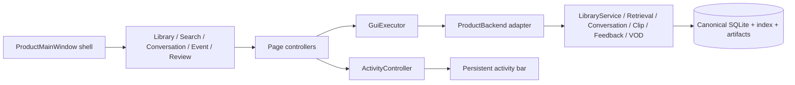
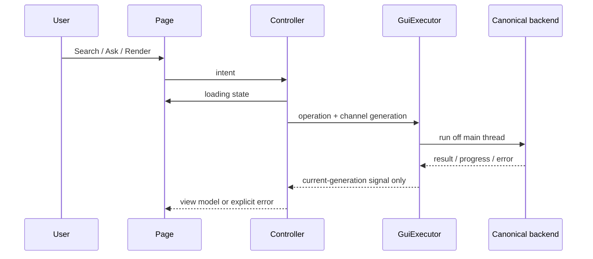

# ACFV Product GUI Architecture

The product GUI is a presentation layer over the canonical ACFV backend. It does not own a second database, search engine, translation pipeline, clip engine, or job store.

## Structure

## Ownership

- `ProductMainWindow` owns navigation, Creator context, persisted shell geometry, the shared executor, and the activity bar. It contains no domain algorithms.
- Pages own widgets and local presentation state. They emit intent and render controller results.
- Controllers map page intent to asynchronous operations, reject stale results by channel generation, and project progress/errors into shared UI state.
- `GuiExecutor` is the only GUI async executor. Search, conversation, import, processing, download, variant generation, render, and thumbnails never run on the Qt main thread.
- `ProductBackend` converts canonical objects to immutable view models. It delegates domain mutation to canonical services.
- Durable job truth remains in the backend job manager. `ActivityController` only presents job snapshots and explicitly distinguishes durable backend IDs from short-lived UI operations.
- Components (`StateStack`, `EmptyState`, `ErrorState`, `MomentList`, `StatusBadge`, `MediaPlayer`) provide consistent states and interaction.

## Signal flow

## Race and lifecycle rules

- Each channel has a monotonically increasing request generation. Results from older Creator, Search, Conversation, Review, thumbnail, or job requests are discarded.
- A copied Clip workflow rebases owned paths to the current output root; it never silently writes back into an old validation tree.
- Thumbnail cache keys contain Recording identity and media revision metadata.
- Closing the shell stops players and rejects new executor submissions. Canonical background jobs remain recoverable through backend state.

## Assets and offline behavior

Theme, styles, and widgets are repository code; startup does not require a CDN or remote icon host. Local Library, retrieval over an existing index, evidence conversation, Clip Review, and export remain local. Twitch VOD and Live controls expose offline/unavailable states instead of indefinite loading.
