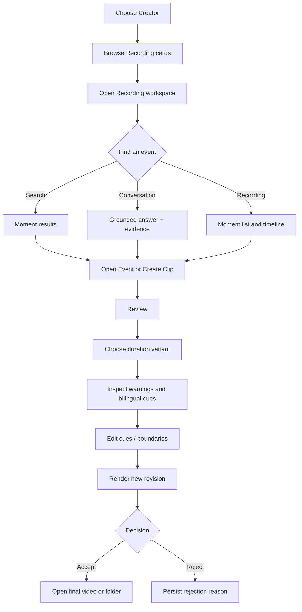

# ACFV GUI User Flow

## Primary flow

## Library and Recording

Select a Creator in the sidebar to apply canonical Creator scope. Recording cards show thumbnails, title, date, duration, source, language, and a simplified status. Opening a card provides the shared player, Moment list, semantic timeline markers, and processing/retry controls. Missing media exposes **重新关联媒体** without deleting or replacing raw data.

## Search

Enter a natural-language query, choose All Library, current Creator, or current Recording, and run Search. The page immediately enters a loading state. Results are Moment cards with Recording context, timestamp, summary, excerpt, Play, Open Event, and Create Clip. Load More grows the result limit in bounded pages. Empty and error states are explicit.

## Conversation

Ask a question in an explicit scope. The response prioritizes Answer and Evidence, reports the grounded runtime mode, and never invents evidence. Each Evidence card can play, open context, or create a Clip. No-evidence is rendered as a stable product state.

## Clip and Review

Create Clip opens Review using the canonical proposal. STANDARD is selected by default. SHORT, STANDARD, LONG, and FULL_EVENT independently show Not Generated, Generating, Ready, Failed, or Not Available. A proposal may be rejected before rendering; acceptance requires a ready output.

Review shows the video, duration controls, bilingual subtitle table, clustered language warnings, and boundary controls. Warning selection seeks the player. English or Chinese edits mark only changed cues as `USER_EDITED`; debounced save does not trigger render. **Render Updated Clip** creates a new revision and keeps the previous revision. Accept/Reject and the selected output persist across restart.

## Add Source

- **Import Local:** choose a local video. Canonical `LibraryService` registers it and starts a durable processing job. Progress and terminal failure remain visible in the activity bar.
- **Download Twitch VOD:** enter an authorized URL and optional range. The GUI delegates to `VodDownloadService`; missing network/auth is an explicit error.
- **Live:** shows Offline when no live session is available. Monitoring remains a canonical backend capability and is not simulated by the GUI.

## Activity and recovery

The bottom bar aggregates transient UI work and durable backend jobs. It shows elapsed state, progress, errors, and safe cancellation only when the backend supports it. Failed Recording processing can be retried from the Recording workspace. Window geometry, splitter position, Creator context, Clip state, subtitle edits, revisions, feedback, and Review decisions survive restart.
